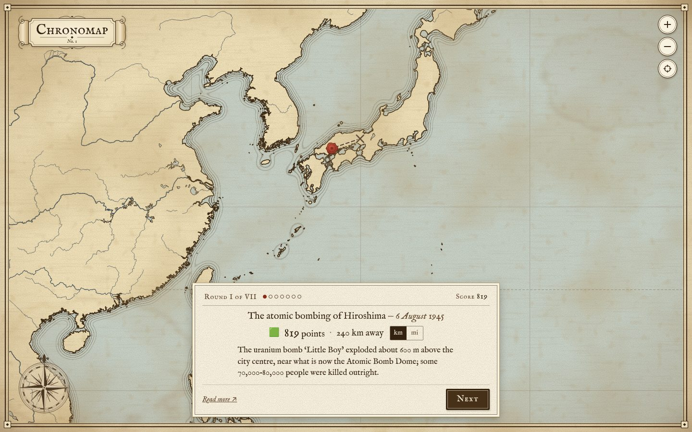
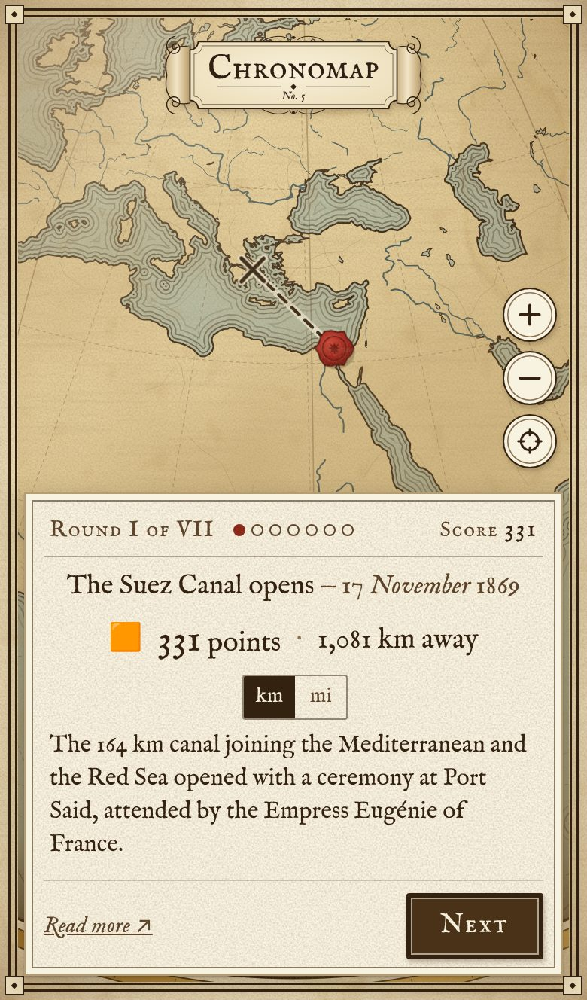

# Chronomap

*A daily atlas of history.* Every day, everyone gets the same seven events from
history, each with its date. Mark on an antique library globe where each one happened:
the nearer your mark, the more points, up to 1,000 a round. Questions get harder
from the first to the seventh.



<p align="center"></p>

- Static site: Vite and TypeScript, no framework and no backend.
- A globe drawn on `<canvas>` with [d3-geo](https://github.com/d3/d3-geo)'s
  orthographic projection, from bundled [Natural Earth](https://www.naturalearthdata.com/)
  data: land, coastline, major rivers and lakes only. There are no borders and no
  labels.
- Styled as a Victorian library globe: varnished, yellowed paper gores with
  seams and craquelure, water-lined coasts, an unlabelled graticule, a brass
  meridian ring and a wooden horizon ring on a turned stand, with the parchment,
  compass rose, scrolled cartouche and IM Fell type around it.
- Turn it by dragging (with a little inertia), zoom with wheel, pinch, buttons or
  keyboard, down to about 100 m per pixel. Finer coastline tiles stream in only
  when you zoom in.
- 1,280 questions (about 180 per difficulty tier, from every continent) with notes
  and sources, checked by
  `npm run validate`.
- **Read more** after each answer: the event's entry in a Victorian gazetteer,
  with our note, Wikipedia's summary and a picture, fetched only once your
  guess is locked in, and **Further reading**: two or three real books on the
  event, each checked against Open Library.
- Scoring gives credit for the right country, using Natural Earth's country
  outlines. They are used for scoring only and never drawn.

## Running it

Requires Node 20 or newer.

```bash
npm install
npm run dev          # http://localhost:5173
```

| Command                    | What it does                                                   |
| -------------------------- | -------------------------------------------------------------- |
| `npm run dev`              | Dev server with hot reload                                     |
| `npm run build`            | Type-check and build the static site into `dist/`              |
| `npm run preview`          | Serve the built `dist/` locally                                |
| `npm test`                 | Unit tests (scoring, globe, dates, daily, storage, Read more)  |
| `npm run validate`         | Check the question bank (see below)                            |
| `npm run check`            | Type-check + tests + validate, as CI does                      |
| `npm run check:places`     | Show the nearest towns / ancient sites to each question        |
| `npm run check:sources`    | Check every source gives a usable Wikipedia summary (network)  |
| `npm run reading:verify`   | Check the Further reading books on Open Library, then build them (network) |
| `npm run reading:build`    | Rebuild the Further reading list from earlier checks (no network) |
| `npm run simulate:scoring` | Expected scores for good, average and poor players (see below) |
| `npm run build:geodata`    | Rebuild the globe's map data from Natural Earth (rarely needed) |
| `npm run build:countries`  | Rebuild the scoring-only country outlines (rarely needed)      |
| `npm run schedule:extend`  | Append days to the frozen puzzle schedule                      |

## How to play

1. **Begin** shows the first event and its date.
2. Pan and zoom, then click or tap where you think it happened. Click again to
   move your mark, then **Confirm**.
3. The answer appears as a red wax seal, with a dashed great-circle line from
   your mark, the distance (km or miles), your points and a short note. If
   being in the right country lifted your score, it says so. **Read more**
   opens the event's entry (see [Read more](#read-more)).
4. After seven rounds you get your total, a breakdown, your streak, how
   everyone else did that day (see [Daily stats](#daily-stats)) and a
   **Share** button that copies a spoiler-free result:

   ```
   Chronomap #42 — 6,020/7,000 🟩🟩🟩🟨🟩🟨🟧
   ```

Reopening the page after finishing shows your results and a countdown to the
next puzzle. Leaving mid-game resumes where you left off, including a mark you
hadn't confirmed yet.

**Past puzzles.** **Past puzzles** (on the start and results screens) opens the
Almanac: a ledger of every puzzle from launch to yesterday, with your score for
each day you played. Today's puzzle joins it tomorrow, and there are no future
days. Any day you didn't finish on the day opens at `?day=YYYY-MM-DD` and plays
exactly like the daily, marked with a red *Archive* stamp. Archive games are
saved apart from daily results: they never count towards your streak, played
days or average, and their share line reads `Chronomap #3 · Archive — …`. A
daily game you left unfinished carries on in the archive.

**Review and replay.** Every finished day in the Almanac shows its score with
two links:
- **Review** (`?day=…&mode=review`) steps through the seven questions one at a
  time: the event and date, your mark, the answer and the arc between them,
  the distance, the score, and Read more with Further reading. It is
  read-only and saves nothing. Today's puzzle can be reviewed once it is
  played: "Review today's puzzle" is on its results screen, and on the start
  and results screens of any other day. Daily games saved before guesses were
  stored kept only their scores; their review says "Your guesses weren't
  recorded for this day" and still shows every answer and Read more.
- **Replay** (`?day=…&mode=practice`) plays the day again, stamped *Practice*
  and labelled "Practice: not scored". It is saved in a slot of its own, so it
  never overwrites the original result and never touches the streak,
  averages, daily stats or leaderboards (nothing is submitted, and there is
  no share line). The results show both: "Original: 5,210 · Practice: 6,040".

Unplayed past days open as before.

**Touch and mouse:** drag to turn the globe; a press that moves more than a few
pixels (or uses two fingers, or stops a spinning globe) never places a mark,
so only a deliberate tap or click does. On the reveal, the globe turns (and
zooms out if need be) until your mark and the answer are both in view, then
draws the great-circle route between them.

**Keyboard:** Tab to the globe, then the arrow keys turn it, `+`/`−` zoom,
Space marks the centre crosshair and Enter confirms or continues. `Esc` closes
a Read more entry, leaves the results map and closes the Almanac.

## Read more

Once a guess is confirmed, **Read more** (on the reveal, beside each round of
the results, and on the results map) opens that event's entry in *A Gazetteer
of History*: a page of aged paper with the event, its date, our note as the
lead under a red drop cap, then the summary of its Wikipedia article and the
article's picture, printed like an engraving. *Continue reading on Wikipedia*
opens the article in a new tab, and every entry carries the credit the licence
asks for: "From Wikipedia, CC BY-SA", linking to the article and the licence.
On phones it is a full-screen sheet. It closes with its buttons, `Esc` or a
tap outside, and on the reveal it has its own **Next question** button, so
reading never costs an extra tap. Archive games have it too.

**No spoilers.** An article's title names the answer, so nothing about a
question is fetched, or put in the page, until its guess is confirmed: no
prefetching, no link, no title in a request. All requests go through one guard
([`src/game/readMore.ts`](src/game/readMore.ts)) that holds the day's questions
and refuses any that haven't been answered. The summary is fetched as the
reveal starts, so it's usually there by the time you tap. Two questions citing
the same article (Hiroshima and Nagasaki) both wait until both are answered.
`tests/readMore.test.ts` plays whole daily and archive games in a simulated
browser, recording every request, and fails if anything about a question shows
up before its guess is confirmed.

**Where it comes from.** The summary comes from Wikipedia's REST API
(`https://en.wikipedia.org/api/rest_v1/page/summary/<title>`, the title taken
from the question's `source`), straight from the player's browser: no key, no
server of ours. Like any visit to Wikipedia, Wikimedia sees the request (and
the player's IP address); nothing else about the player or their game is sent. The extract is shown as plain text (any HTML stripped).
Pictures are shown only when they come from Wikimedia Commons, where every
file is freely licensed, with a link to the file's page for its author and
licence; pictures kept on Wikipedia itself are often non-free and are left
out. Summaries are kept in memory for the visit.

**When Wikipedia is slow or down.** After 4 seconds without an answer (or on
any error), the entry shows our note and the link to Wikipedia only. The game
never waits for it.

### Further reading

Under the Wikipedia summary, **Further reading** lists two or three books on
the event: the cover (from Open Library, toned sepia, loaded lazily and left
out if there isn't one), title, author, year of first publication, a line on
why it's worth reading, and a link to the book's Open Library page. Like the
rest of the entry it appears only once the guess is confirmed, in the daily
game, the results, the review map and archive games alike.

**Where the books come from.** Every question has one or two `topics` in
`src/data/questions.json` (198 of them, such as `napoleon`, `vikings` or
`war-of-the-pacific`). Each topic in
[`data/reading/topics.json`](data/reading/topics.json) recommends three books,
usually a readable popular history and an authoritative scholarly one, and
[`data/reading/events.json`](data/reading/events.json) adds a book of its own
for events that have an obvious one (Ross King on Brunelleschi's dome,
*A Bridge Too Far* for Arnhem). An entry shows the event's own book first, then
its topics' books in turn, three in all.

**Every book is checked.** Invented books are the main risk with a list like
this, so nothing is shown unless Open Library has it.
[`scripts/verify-reading.ts`](scripts/verify-reading.ts) searches Open Library
for each book by title and author, and counts it only if a work there has the
same title (ignoring case, punctuation, subtitles and dates) and the first
author's surname. It records the Open Library work and a cover in
[`data/reading/openlibrary.json`](data/reading/openlibrary.json), then builds
`src/data/reading.json` from the books it confirmed and nothing else. Anything
not found, or found only under another author, is left out and listed in
[`data/reading/REPORT.md`](data/reading/REPORT.md) with the pass rate and the
number of books each question ends up with. `tests/reading.test.ts` rebuilds
the list from those records and fails if the shipped file differs, so an
unchecked book can't slip in by hand, and also fails if any question has
fewer than two books.

```bash
npm run reading:verify                    # check new or changed books, then build
npm run reading:verify -- --tier 1        # just the books tier-1 questions use
npm run reading:verify -- --topic vikings # just one topic
npm run reading:verify -- --recheck       # ask again about every book
npm run reading:build                     # rebuild from earlier checks, no network
```

Batches can run one after another: answers are saved as they arrive, and the
list is rebuilt from everything checked so far, so a partial run is usable.
Where Open Library can't be reached, run the **Verify further reading**
workflow from the Actions tab (optionally for some tiers only): it does the
same checks on GitHub and commits the results to the branch.

**Loading.** The list is a file of its own (about 235 KB, 55 KB gzipped),
fetched the first time a Read more entry opens and never before, so it costs
nothing until then and isn't in the script bundle. Covers come straight from
`covers.openlibrary.org`, only for the books in the open entry.

## Scoring

Distance is the great-circle (haversine) distance between your mark and the
answer, never screen distance. Points fall off along a bell curve, so a near
miss keeps almost everything and a wild guess scores nothing:

```
score = 1000                          if distance ≤ bullseyeKm
score = round(1000 · e^(−(d′/k)²))    otherwise, where d′ = distance − bullseyeKm
```

`k` and `bullseyeKm` come from the question, or from its tier's defaults if
they are `null`. k grows with the tier: anyone who knows a famous event can put
it within a few km, so a 1,000 km miss on tier 1 is a real mistake, while even
experts can only place a deep cut within a few hundred. Later tiers are harder
because they are obscure, not because the target shrinks.

| Tier | k (km) | Bullseye (km) | At 250 km | At 500 km | At 1,000 km | At 2,000 km |
| ---- | ------ | ------------- | --------- | --------- | ----------- | ----------- |
| 1    | 1,000  | 30            | 953       | 802       | 390         | 21          |
| 2    | 1,125  | 25            | 961       | 837       | 472         | 46          |
| 3    | 1,250  | 20            | 967       | 863       | 541         | 81          |
| 4    | 1,375  | 15            | 971       | 883       | 599         | 124         |
| 5    | 1,500  | 15            | 976       | 901       | 650         | 174         |
| 6    | 1,625  | 10            | 978       | 913       | 690         | 223         |
| 7    | 1,750  | 10            | 981       | 925       | 726         | 274         |

**The right country.** For events on land, a mark in the same modern country as
the answer scores at least a floor, which is smaller for big countries:

- 500 for countries up to an equivalent radius √(area/π) of 500 km (about
  800,000 km²: the UK, Germany, France, Spain, Turkey…);
- 250 from 1,500 km (Australia, Brazil, the USA, China, Canada, Russia);
- log-linear in between (South Africa 450, Mexico 400, India 340).

"Same country" in Russia can mean 2,000 km away, so a flat floor would pay
more there than for a near miss across a border elsewhere. The floor only
counts within 2,500 km of the answer, which leaves out overseas territories (a
mark in French Guiana doesn't count for Paris). Countries come from Natural
Earth's admin-0 outlines in `src/data/countries.topo.json`. They are used only
for scoring, loaded in the background once the map is up: nothing in `src/map`
imports them (a test checks), and the game never names a country.

**At sea.** Events at sea (`atSea: true`) get no country floor. Instead their
k defaults to 1.25 × the tier's; the few far out in open ocean set 1.5 ×.

**Spread-out events.** A front, a disputed site or a migration has a bullseye
of about half its extent, so a mark anywhere on it scores 1,000. Campaigns and
expeditions also get 1.25 × the tier's k.

Share squares: 🟩 ≥ 900, 🟨 ≥ 600, 🟧 ≥ 300, 🟥 below 300.

`npm run simulate:scoring` plays the whole bank with simulated good, average
and poor players (and random clicks) and prints the expected score per
question, per tier and per game, next to the formula this one replaced
(exponential, with k shrinking from 1,200 km to 300 km). The best real
player averaged ~4,500 under the old formula; the model puts them at ~6,000
now, an average player at ~4,300 and random clicking at ~190.

## The daily puzzle

- The day follows the calendar in **Europe/London** and changes at local
  midnight there (GMT or BST). Puzzle No. 1 was played on
  `LAUNCH_DATE` = 2026-11-06 (`src/game/daily.ts`).
- Q1 comes from tier 1, Q2 from tier 2, and so on.
- **The schedule is frozen.** `src/data/schedule.json` lists the seven
  question ids for every day from launch, one day per line, and the game reads
  each day's puzzle from it. A day in the schedule never changes, whatever
  happens to the question bank, so past puzzles (and the archive) stay exactly
  as they were played. A test checks that adding questions changes no
  scheduled day.
- `npm run schedule:extend` appends days (by default to a year from today;
  `-- --until YYYY-MM-DD` for another date). It never changes a day that has
  been played; `--refresh` (below) only redraws days after tomorrow. New days
  follow the same rules tier by tier: a *cycle* plays every question in the
  pool once, in a seeded random order (mulberry32), before any repeats, and
  the same question never appears two days running. Questions added to the
  bank join the cycle in progress, so they come up within a pool's worth of
  days.
- `npm run validate` fails if a scheduled question has been removed or has
  changed tier, and warns 90 days before the schedule runs out (it fails 14
  days before). If the schedule ever did run out, later days would be worked
  out from the current bank, but they wouldn't be frozen until committed.
- Everything is computed in the browser. Progress, history, streaks, archive
  games and the km/miles choice live in `localStorage` (every access is
  wrapped in `try/catch`, so private browsing still plays, it just doesn't
  remember). The data under `chronomap:v1` carries its own `version`: version
  2 keeps every finished daily game's rounds in full (question, guess to about
  a metre, distance) for review, where version 1 kept only scores. Version 1
  data is read as version 2 without losing anything; the one game version 1
  did keep in full (the latest) fills in its own day's guesses
  (`migrate()` in [`src/game/storage.ts`](src/game/storage.ts)).

**After adding questions,** run `npm run schedule:extend -- --refresh` and
commit `schedule.json`. It redraws only the scheduled days after tomorrow,
which nobody can have seen, so the new questions join the cycles in progress
straight away; today, tomorrow and every past day stay exactly as they were.
Without `--refresh`, new questions wait until the schedule is extended past its
current end. Never remove a scheduled question or change its tier: the
validator refuses.

## Daily stats

When stats are switched on, the results screen also shows how everyone else
did that day:
- the number of players and their average;
- "You scored better than X% of players";
- an engraved histogram of the day's scores with yours marked in red;
- the hardest question;
- everyone's average for each question, beside your own scores.

With fewer than 5 players it says it's early days, and the numbers are fetched
again each time the results are opened. The share line adds "· Top X%" for
scores in the top half once there are 5 or more players. Archive games are
compared with that day's players but never counted.

**What is sent.** Only when today's daily puzzle is finished, and only:
- the date;
- the total;
- the seven round scores;
- a random player ID made once and kept in `localStorage`.

Nothing else is sent or stored: no accounts or cookies, and no names unless
the player chooses one for the [Roll of Honour](#roll-of-honour). Like any web
request, Supabase's request logs see the visitor's IP address, but the table
doesn't store it. Archive games never submit.

**Where it lives.** A Supabase table set up by
[`supabase/daily-stats.sql`](supabase/daily-stats.sql). Run it once in the
Supabase SQL Editor; it is safe to re-run.
- **One result per player per day**, enforced by a unique constraint.
- **Check constraints:** a total of 0–7000, seven rounds of 0–1000 each, and
  rounds that sum to the total.
- **Row Level Security:** the public role may insert today's result (Europe/London)
  and nothing else. Nobody can read, change or delete raw rows through the API,
  so player IDs never leave the database.
- **Reading stats:** the browser calls `daily_stats(date, score)`, a
  `SECURITY DEFINER` function with a fixed `search_path`. It returns only
  aggregates: count, average, a histogram in 14 bands of 500, per-question
  averages and a percentile. It refuses future dates.
- **Usernames and leaderboards:** a second script; see
  [Roll of Honour](#roll-of-honour).

**Configuration.** The build reads two Vite env vars:

| Variable                        | Value                                              |
| ------------------------------- | -------------------------------------------------- |
| `VITE_SUPABASE_URL`             | The project URL, `https://<project>.supabase.co`   |
| `VITE_SUPABASE_PUBLISHABLE_KEY` | The publishable (anon) key, `sb_publishable_…`     |

- **Local development:** copy `.env.example` to `.env.local` (gitignored).
- **GitHub Pages:** add both as repository secrets; the workflow passes them
  to the build.
- **Netlify:** add both under Site configuration → Environment variables.
- **Unset:** the game has no stats panel and nothing is sent.
- **Never the secret key.** Use only the publishable key, never the secret or
  service-role key: the build refuses those.

**Resilience.** The client uses plain `fetch` rather than `supabase-js`, which
would add ~59 KB gzipped for two calls. Each call times out after 3 seconds
and never throws. If Supabase is down or slow:
- the game plays exactly as before;
- the panel says "Stats unavailable";
- a failed submission is retried once on the next visit that day, then dropped.

## Roll of Honour

With stats switched on, "Roll of Honour" (on the start and results screens)
opens the leaderboards: four ledger index tabs.

| Tab     | Ranks                                                                 |
| ------- | --------------------------------------------------------------------- |
| Today   | today's daily scores                                                  |
| Total   | points across every daily game, with games played                     |
| Best    | each player's single best day, with its date; ties go to whoever made it first |
| Average | average daily score, with games played; needs at least 10 games      |

Each shows the top 25, plus the player's own row if they are further down.
Equal values share a rank ("=2nd"), except on Best, where the earlier day
(then the earlier submission that day) ranks higher. Only daily results feed
the boards, and the database only takes those on their own day, so archive
games never count.

**Optional names.** A player appears only once they claim a username. There is
no email and no password: the name is linked to the random player ID their
browser already sends with its results, so every past daily game counts
straight away. Players without a name play and count in the daily stats
exactly as before.

**Asking for a name.** After today's daily, a player without a name sees
"Claim your place on the leaderboard" on the results screen, above the
breakdown and stats, with where they would stand ("You'd be 4th of 37
today": their rank among today's names, or, below the 25 rows the board
lists, the share of today's players they beat). "Choose a username" opens
the claim form right there; "Not now" puts the prompt off for 3 days, and
after three of those it stops appearing on its own. A "Claim a username"
link stays under the masthead and among the links on the start and results
screens for as long as the player has no name. Nothing ever blocks play or
the results.
- 3–20 letters, numbers or underscores, with at least one letter; unique
  ignoring case.
- Reserved names (admin, moderator, chronomap, support, you, …) and a short
  profanity blocklist are refused, including digit-for-letter spellings
  (`4dm1n`, `sh1t`). Short words that hide inside innocent ones (Dickens,
  Sussex) only count as whole words.
- The rules live in [`src/game/username.ts`](src/game/username.ts) (instant
  feedback) and `username_problem()` in the SQL (the authority); a test runs
  both on the same names.

**The player ID is the secret.** Holding it is what proves a profile is
yours, so no function ever returns it. Under "Your recovery code" the player
sees it as a 28-character code (Crockford base32 with two check characters,
so typos are caught) to copy to another device, where "Restore from a code"
switches that browser to the same player. The panel warns that anyone with
the code can use the name.

**Setting it up.** After `daily-stats.sql`, run
[`supabase/profiles-leaderboards.sql`](supabase/profiles-leaderboards.sql)
once in the Supabase SQL Editor; it is safe to re-run. It adds a `profiles`
table (Row Level Security on, no grants: unreadable through the API) and
`SECURITY DEFINER` functions with an empty `search_path`:
- `claim_username(player_id, name)`: claim or change a name;
- `my_profile(player_id)`: the name (if any) and number of daily games;
- `leaderboard(board, player_id)`: the top 25 and the player's own row, with
  only rank, username, value, games played and date.

The minimum games for Best average is set once, in
`leaderboard_min_average_games()` at the top of the script; the game reads it
from the server. `tests/leaderboardSql.test.ts` runs both scripts in PGlite
(Postgres in WebAssembly) to check the rankings, the tie-breaking, the name
rules, and that no player ID ever comes back.

**Admin.** In the SQL Editor:

```sql
-- Rename (the new name must fit the format and be free):
update public.profiles set username = 'NewName', updated_at = now()
where lower(username) = lower('OldName');

-- Delete a name (their results stay, anonymous again):
delete from public.profiles where lower(username) = lower('BadName');

-- Check a name against the rules (null means fine):
select public.username_problem('SomeName');
```

To change the blocklists, edit `username_problem()` in the script and in
`src/game/username.ts`, then re-run the script.

## Adding questions

Questions live in [`src/data/questions.json`](src/data/questions.json):

```json
{
  "id": "t3-waterloo",
  "event": "The Battle of Waterloo",
  "dateDisplay": "18 June 1815",
  "year": 1815,
  "tier": 3,
  "lat": 50.6788,
  "lng": 4.4044,
  "k": null,
  "bullseyeKm": 8,
  "note": "Wellington's allied army and Blücher's Prussians defeated Napoleon on the ridges about 15 km south of Brussels, ending the Hundred Days. The Lion's Mound now marks the field.",
  "source": "https://en.wikipedia.org/wiki/Battle_of_Waterloo"
}
```

| Field         | Notes                                                                                               |
| ------------- | --------------------------------------------------------------------------------------------------- |
| `id`          | Unique, kebab-case, never reused. By convention `t<tier>-<slug>`.                                    |
| `event`       | What the player sees. Keep it under ~70 characters.                                                 |
| `dateDisplay` | Free text: `"14 October 1066"`, `"AD 79"`, `"c. 2560 BC"`, `"1814–15"`.                              |
| `year`        | Integer for sorting and checks; negative for BC (no year 0). Must be ≤ 2000 and appear in `dateDisplay`. |
| `tier`        | 1 (famous event, famous place) … 7 (deep cut).                                                      |
| `lat`, `lng`  | Decimal degrees (WGS84) of the actual site: the battlefield, the building, the wreck. Not the nearest city. |
| `k`           | Score decay distance in km, or `null` for the tier default (× 1.25 at sea). Set 1.25 × the tier's for campaigns and expeditions, 1.5 × far out at sea. |
| `bullseyeKm`  | Full marks inside this radius, or `null` for the tier default. For a spread-out or disputed site, about half its extent. |
| `atSea`       | `true` for events at sea (naval battles, wrecks): no country floor and a longer default k. Leave out otherwise. |
| `country`     | Rarely needed: the ADM0_A3 code (e.g. `"JPN"`) of the answer's country when it is on an island too small for the outlines. `npm run validate` says when. |
| `note`        | One or two sentences. If the location is disputed, use the scholarly consensus and say so here.     |
| `source`      | The Wikipedia article about the event itself, never the place it happened (see below). **Read more** shows its summary. |

**Choosing the source.** Always link the article about the historical event,
not the place: *Treaty of Versailles*, not *Hall of Mirrors*; *Assassination of
Mahatma Gandhi*, not *Gandhi Smriti*; *Sinking of the Titanic*, not *Wreck of
the Titanic*. If the event has no article of its own, use the closest
historical one: the expedition, the war or the person at its centre (*First
voyage of James Cook* for Botany Bay, *Second Opium War* for the burning of the
Old Summer Palace, *History of Alexandria* for its founding). The one exception
is a question about building something (a pyramid, a cathedral, a canal),
where the monument's own article is the history of the event; even then, use
an event article if there is one (*Inaugural games of the Colosseum*). The
coordinates still come from the place itself (step 1 below), whatever the
article's own map pin says.

**Choosing a tier.** Difficulty is how obscure the event is *and* how hard its
place is to pin down. Tiers 1–2 are world-famous events in famous places (the
name may give the place away). Tiers 3–4 need regional knowledge (Waterloo,
Runnymede). Tiers 5–6 are less familiar events, or ones whose location isn't
obvious from the name (Talas, Tordesillas). Tier 7 is for deep cuts. From tier
5 up, avoid names that hand over the answer: "The Great Siege of Malta" became
"The Knights of St John withstand a great Ottoman siege".

**Checking accuracy.**

1. Take coordinates from the site's own Wikipedia article or a primary
   gazetteer, to four decimal places for precise sites.
2. Run `npm run check:places -- <id>` to see the nearest towns (GeoNames) and,
   for ancient events, Pleiades sites. A battle that sits 2 km from its
   namesake village is right; one 3,000 km away has a swapped sign. (The first
   run downloads ~35 MB of gazetteers into `.cache/`; they are never bundled.)
3. Run `npm run validate` and fix everything it reports.
4. Run `npm run check:sources -- <id>` to check the source against Wikipedia:
   it must be an article, not a disambiguation page, and not a redirect to a
   section of something else (the summary would be of the whole article).
   Plain redirects are reported; `--fix` points them at their target. It
   also flags articles placed far from your coordinates and articles without
   a free picture. It needs the network, so it isn't part of `npm run check`.

### What `npm run validate` checks

- Schema and types; kebab-case, unique ids; no duplicate events (ignoring case
  and punctuation); spots under 1 km apart are flagged.
- Latitude/longitude in range.
- Year ≤ 2000, shown in `dateDisplay`, and BC consistent with its sign.
- Notes are one or two sentences; sources are https URLs, and Wikipedia
  articles (it notes any two questions that share one).
- **Land or coast:** each point must be on land, or within 50 km of a coast,
  tested against the same Natural Earth geometry the game draws (the detailed
  tiles where available), unless it is marked `atSea`. A point marked `atSea`
  mustn't be well inland.
- **Country:** a land event that falls in no country of the scoring outlines
  is flagged (it would get no country floor); name its country with `country`.
- **Even spread:** at least 40 questions per tier, with tiers within 25% of each
  other.

It also prints questions by region and era for each tier, so gaps are easy to
see. It exits non-zero on any error, so CI and Netlify refuse to deploy a
broken bank.

## Deploying

The build is a fully static `dist/` folder with relative paths (Vite
`base: './'`), so it works at a domain root or in a sub-folder.

**GitHub Pages.** `.github/workflows/deploy.yml` validates, tests and builds every
push and pull request, and deploys `main` to Pages. In the repository settings,
under *Pages → Build and deployment*, set the source to **GitHub Actions**.

**Netlify.** Connect the repository; `netlify.toml` already sets the build
command (`npm run validate && npm run build`), the publish folder (`dist`) and
cache headers.

**Anywhere else.** Run `npm run build` and upload `dist/` to any static host.
Serve `assets/` with long-lived caching. Detail tiles in `geo/globe/` are
requested with a version query string.

## How the globe works

```
scripts/build-geodata.ts      Natural Earth → src/data/globe.topo.json
                                            → public/geo/globe/<col>-<row>.json
scripts/build-countries.ts    Natural Earth admin-0 → src/data/countries.topo.json
                                            (scoring only, never drawn)
src/map/globeData.ts          the data's layout and its 15° detail grid
src/map/GlobeView.ts          canvas drawing, styling, gestures, markers, fly-tos
src/map/fastOrtho.ts          the fast orthographic projector used for drawing
src/map/globeMath.ts          tap vs drag, screen → lng/lat, rotation, view fitting
src/map/ornaments.ts          compass rose, cartouche, guess mark, wax seal
src/map/texture.ts            parchment grain, fibres, foxing and stains (SVG filters)
src/map/glyphs.ts             hand-sketched decoration glyphs and their sprite atlas
```

- **Projection.** `d3.geoOrthographic`, showing only the near hemisphere. North
  stays up: dragging turns the globe about its axis and tips it towards the
  poles, never rolls it. At deep zoom the view is effectively flat.
- **Geodata.** The build script downloads the pinned Natural Earth v5.1.2
  GeoJSON once and keeps it in plain longitude/latitude, since the globe
  projects it afresh as it turns. Three levels:
  - **coarse** 1:110m land, drawn while the globe moves and is zoomed out;
  - a **base** level, shipped with the page (~140 KB gzip);
  - **detail tiles** (1:10m coastlines, more rivers and lakes) cut on a
    15° grid, fetched only for the cells in view once you zoom past about
    2.5 km per pixel.

  Every polygon's winding is checked so d3 never fills the wrong side of the
  sphere. Coastlines leave out Natural Earth's artificial cuts along the
  antimeridian and the South Pole, so no seam is ever inked. Reservoirs are
  left out as anachronisms. The outputs are committed.
- **Drawing.** Each frame projects the geometry with a small dedicated
  orthographic projector (`fastOrtho.ts`): unit vectors computed once, then a
  few multiplications per point. That's several times faster than d3's general
  pipeline, and checked pixel for pixel against d3 over 150 random views. d3
  still projects the markers and the route, which sit in an SVG overlay and
  hide when they turn to the far side.
- **Smoothness.** While the globe moves (drag, inertia, zoom, fly-to) it draws
  the lighter geometry and skips the costly layers: water-lining, rivers,
  craquelure. About 140 ms after it settles, it redraws in full. With the CPU
  slowed 4× at 390 px wide, a moving frame takes about 6 ms.
- **Water-lining.** Ripple lines ruled offshore at fixed pixel distances: the
  coastline is stroked wide in ink, then slightly narrower in sea colour, from
  the outermost ripple in; the land fill covers their inland halves.
- **Styling.** Gore seams every 30° and the polar calottes, a fine craquelure
  (random hairline cracks in longitude/latitude, so they turn with the globe),
  yellowed varnish, tea-stained toning towards the rim and the light on a ball
  (highlight top-left, darkening to the edge). The brass meridian ring and the
  wooden horizon ring and stand scale with zoom but don't rotate.
- **Decoration glyphs.** Mountains, deserts, forests, sea ripples, ships and a
  couple of sea monsters, sketched procedurally in sepia ink by `glyphs.ts`
  with a seeded wobbling, tapering pen, then baked once into a sprite atlas.
  `glyphs.html` (built, but never linked from the game) is a specimen sheet of
  every glyph: `npm run dev` and open `/glyphs.html`, or add `/glyphs.html` to
  a deploy preview's address.
- **No text on the globe.** The only lettering is the title in the cartouche.

## Accessibility

- Every control is a real button, with visible focus rings. Keyboard play is
  described above. A Read more entry is a modal dialog: focus moves to its
  heading, stays inside it, and returns to the button that opened it. When you play by keyboard, focus moves to the globe and then to
  the next action.
- Rounds and results are announced in a polite live region; the globe has an
  application role and instructions.
- Text is dark ink on cream paper (contrast above 12:1 for question text).
- `prefers-reduced-motion` turns off the fly-to animations, inertia, the route
  drawing and other motion.

## Credits

- Map data: [Natural Earth](https://www.naturalearthdata.com/), public domain.
- Typefaces: IM Fell English and IM Fell English SC by Igino Marini, SIL Open
  Font License, via [Fontsource](https://fontsource.org/).
- [D3](https://d3js.org/) and [TopoJSON](https://github.com/topojson) (ISC licence).
- Coordinate checks (`check:places`, development only): GeoNames via
  [cities.json](https://github.com/lutangar/cities.json) (CC BY 4.0) and the
  [Pleiades](https://pleiades.stoa.org/) gazetteer of ancient places (CC BY 3.0).
- Question notes are original; each question links to a source for its location.
- Read more: text from [Wikipedia](https://en.wikipedia.org/), under
  [CC BY-SA 4.0](https://creativecommons.org/licenses/by-sa/4.0/), credited
  and linked in each entry; pictures from
  [Wikimedia Commons](https://commons.wikimedia.org/), each linked to its
  file page for author and licence.
