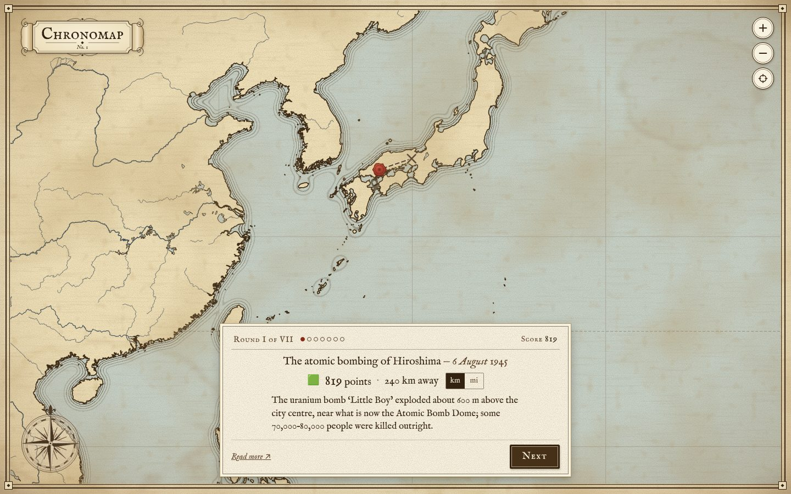
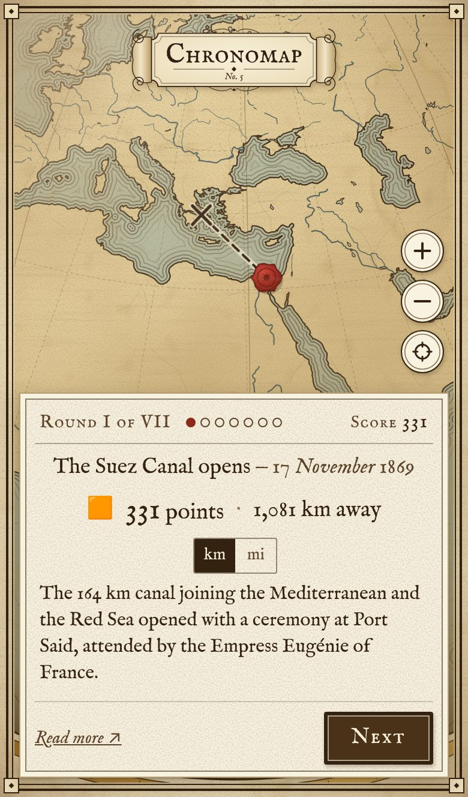

# Chronomap

*A daily atlas of history.* Every day, everyone gets the same seven events from
history, each with its date. Mark on an antique map where each one happened:
the nearer your mark, the more points, up to 1,000 a round. Questions get harder
from the first to the seventh.



<p align="center"></p>

- Static site: Vite and TypeScript, no framework and no backend.
- Map drawn as SVG with [d3-geo](https://github.com/d3/d3-geo) (Mercator, 75°S–80°N)
  from bundled [Natural Earth](https://www.naturalearthdata.com/) data: land,
  coastline, major rivers and lakes only. There are no borders and no labels.
- Victorian engraved style: parchment, water-lined coasts, unlabelled graticule,
  graduated neatline, compass rose, scrolled cartouche, IM Fell type.
- Pan and zoom with mouse, trackpad, pinch, buttons or keyboard. Finer coastline
  tiles stream in only when you zoom in.
- 280 questions (40 per difficulty tier) with notes and sources, checked by
  `npm run validate`.
- Scoring gives credit for the right country, using Natural Earth's country
  outlines. They are used for scoring only and never drawn.

## Running it

Requires Node 20 or newer.

```bash
npm install
npm run dev          # http://localhost:5173
```

| Command                    | What it does                                                   |
| -------------------------- | -------------------------------------------------------------- |
| `npm run dev`              | Dev server with hot reload                                     |
| `npm run build`            | Type-check and build the static site into `dist/`              |
| `npm run preview`          | Serve the built `dist/` locally                                |
| `npm test`                 | Unit tests (scoring, countries, dates and DST, daily, storage) |
| `npm run validate`         | Check the question bank (see below)                            |
| `npm run check`            | Type-check + tests + validate, as CI does                      |
| `npm run check:places`     | Show the nearest towns / ancient sites to each question        |
| `npm run simulate:scoring` | Expected scores for good, average and poor players (see below) |
| `npm run build:geodata`    | Rebuild the map data from Natural Earth (rarely needed)        |
| `npm run build:countries`  | Rebuild the scoring-only country outlines (rarely needed)      |

## How to play

1. **Begin** shows the first event and its date.
2. Pan and zoom, then click or tap where you think it happened. Click again to
   move your mark, then **Confirm**.
3. The answer appears as a red wax seal, with a dashed great-circle line from
   your mark, the distance (km or miles), your points and a short note. If
   being in the right country lifted your score, it says so.
4. After seven rounds you get your total, a breakdown, your streak and a
   **Share** button that copies a spoiler-free result:

   ```
   Chronomap #42 — 6,020/7,000 🟩🟩🟩🟨🟩🟨🟧
   ```

Reopening the page after finishing shows your results and a countdown to the
next puzzle. Leaving mid-game resumes where you left off, including a mark you
hadn't confirmed yet.

**Keyboard:** Tab to the map, then the arrow keys pan, `+`/`−` zoom, Space marks
the centre crosshair and Enter confirms or continues. `Esc` leaves the results
map.

## Scoring

Distance is the great-circle (haversine) distance between your mark and the
answer, never screen distance. Points fall off along a bell curve, so a near
miss keeps almost everything and a wild guess scores nothing:

```
score = 1000                          if distance ≤ bullseyeKm
score = round(1000 · e^(−(d′/k)²))    otherwise, where d′ = distance − bullseyeKm
```

`k` and `bullseyeKm` come from the question, or from its tier's defaults if
they are `null`. k grows with the tier: anyone who knows a famous event can put
it within a few km, so a 1,000 km miss on tier 1 is a real mistake, while even
experts can only place a deep cut within a few hundred. Later tiers are harder
because they are obscure, not because the target shrinks.

| Tier | k (km) | Bullseye (km) | At 250 km | At 500 km | At 1,000 km | At 2,000 km |
| ---- | ------ | ------------- | --------- | --------- | ----------- | ----------- |
| 1    | 1,000  | 30            | 953       | 802       | 390         | 21          |
| 2    | 1,125  | 25            | 961       | 837       | 472         | 46          |
| 3    | 1,250  | 20            | 967       | 863       | 541         | 81          |
| 4    | 1,375  | 15            | 971       | 883       | 599         | 124         |
| 5    | 1,500  | 15            | 976       | 901       | 650         | 174         |
| 6    | 1,625  | 10            | 978       | 913       | 690         | 223         |
| 7    | 1,750  | 10            | 981       | 925       | 726         | 274         |

**The right country.** For events on land, a mark in the same modern country as
the answer scores at least a floor, which is smaller for big countries:

- 500 for countries up to an equivalent radius √(area/π) of 500 km (about
  800,000 km²: the UK, Germany, France, Spain, Turkey…);
- 250 from 1,500 km (Australia, Brazil, the USA, China, Canada, Russia);
- log-linear in between (South Africa 450, Mexico 400, India 340).

"Same country" in Russia can mean 2,000 km away, so a flat floor would pay
more there than for a near miss across a border elsewhere. The floor only
counts within 2,500 km of the answer, which leaves out overseas territories (a
mark in French Guiana doesn't count for Paris). Countries come from Natural
Earth's admin-0 outlines in `src/data/countries.topo.json`. They are used only
for scoring, loaded in the background once the map is up: nothing in `src/map`
imports them (a test checks), and the game never names a country.

**At sea.** Events at sea (`atSea: true`) get no country floor. Instead their
k defaults to 1.25 × the tier's; the few far out in open ocean set 1.5 ×.

**Spread-out events.** A front, a disputed site or a migration has a bullseye
of about half its extent, so a mark anywhere on it scores 1,000. Campaigns and
expeditions also get 1.25 × the tier's k.

Share squares: 🟩 ≥ 900, 🟨 ≥ 600, 🟧 ≥ 300, 🟥 below 300.

`npm run simulate:scoring` plays the whole bank with simulated good, average
and poor players (and random clicks) and prints the expected score per
question, per tier and per game, next to the formula this one replaced
(exponential, with k shrinking from 1,200 km to 300 km). The best real
player averaged ~4,500 under the old formula; the model puts them at ~6,000
now, an average player at ~4,300 and random clicking at ~190.

## The daily puzzle

- The day follows the calendar in **Europe/London** and changes at local
  midnight there (GMT or BST). Puzzle No. 1 was played on
  `LAUNCH_DATE` = 2026-11-06 (`src/game/daily.ts`).
- Q1 comes from tier 1, Q2 from tier 2, and so on.
- Each tier is played in *cycles*. A cycle shows every question in that tier's
  pool once, in an order shuffled by a seeded PRNG (mulberry32, seeded from the
  tier and cycle number). So everyone sees the same questions, and no question
  repeats until its whole pool has been used. A new cycle never opens with the
  question that closed the previous one.
- Everything is computed in the browser. Progress, history, streaks and the
  km/miles choice live in `localStorage` (every access is wrapped in
  `try/catch`, so private browsing still plays, it just doesn't remember).

**Changing the bank changes the schedule.** Pools are sorted by id and their
size sets the cycle length, so adding or removing questions in a tier reshuffles
that tier's future days (and could repeat a question early within the current
cycle). A game someone has already started is safe: it stores its question ids
and keeps them. If the schedule matters, add questions in batches just before a
cycle boundary, which is every pool-size days from launch.

## Adding questions

Questions live in [`src/data/questions.json`](src/data/questions.json):

```json
{
  "id": "t3-waterloo",
  "event": "The Battle of Waterloo",
  "dateDisplay": "18 June 1815",
  "year": 1815,
  "tier": 3,
  "lat": 50.6788,
  "lng": 4.4044,
  "k": null,
  "bullseyeKm": 8,
  "note": "Wellington's allied army and Blücher's Prussians defeated Napoleon on the ridges about 15 km south of Brussels, ending the Hundred Days. The Lion's Mound now marks the field.",
  "source": "https://en.wikipedia.org/wiki/Battle_of_Waterloo"
}
```

| Field         | Notes                                                                                               |
| ------------- | --------------------------------------------------------------------------------------------------- |
| `id`          | Unique, kebab-case, never reused. By convention `t<tier>-<slug>`.                                    |
| `event`       | What the player sees. Keep it under ~70 characters.                                                 |
| `dateDisplay` | Free text: `"14 October 1066"`, `"AD 79"`, `"c. 2560 BC"`, `"1814–15"`.                              |
| `year`        | Integer for sorting and checks; negative for BC (no year 0). Must be ≤ 2000 and appear in `dateDisplay`. |
| `tier`        | 1 (famous event, famous place) … 7 (deep cut).                                                      |
| `lat`, `lng`  | Decimal degrees (WGS84) of the actual site: the battlefield, the building, the wreck. Not the nearest city. Must be between 75°S and 80°N. |
| `k`           | Score decay distance in km, or `null` for the tier default (× 1.25 at sea). Set 1.25 × the tier's for campaigns and expeditions, 1.5 × far out at sea. |
| `bullseyeKm`  | Full marks inside this radius, or `null` for the tier default. For a spread-out or disputed site, about half its extent. |
| `atSea`       | `true` for events at sea (naval battles, wrecks): no country floor and a longer default k. Leave out otherwise. |
| `country`     | Rarely needed: the ADM0_A3 code (e.g. `"JPN"`) of the answer's country when it is on an island too small for the outlines. `npm run validate` says when. |
| `note`        | One or two sentences. If the location is disputed, use the scholarly consensus and say so here.     |
| `source`      | A page where the coordinates can be checked, usually Wikipedia.                                     |

**Choosing a tier.** Difficulty is how obscure the event is *and* how hard its
place is to pin down. Tiers 1–2 are world-famous events in famous places (the
name may give the place away). Tiers 3–4 need regional knowledge (Waterloo,
Runnymede). Tiers 5–6 are less familiar events, or ones whose location isn't
obvious from the name (Talas, Tordesillas). Tier 7 is for deep cuts. From tier
5 up, avoid names that hand over the answer: "The Great Siege of Malta" became
"The Knights of St John withstand a great Ottoman siege".

**Checking accuracy.**

1. Take coordinates from the source's infobox or a primary gazetteer, to four
   decimal places for precise sites.
2. Run `npm run check:places -- <id>` to see the nearest towns (GeoNames) and,
   for ancient events, Pleiades sites. A battle that sits 2 km from its
   namesake village is right; one 3,000 km away has a swapped sign. (The first
   run downloads ~35 MB of gazetteers into `.cache/`; they are never bundled.)
3. Run `npm run validate` and fix everything it reports.

### What `npm run validate` checks

- Schema and types; kebab-case, unique ids; no duplicate events (ignoring case
  and punctuation); spots under 1 km apart are flagged.
- Latitude/longitude in range and on the playable sheet.
- Year ≤ 2000, shown in `dateDisplay`, and BC consistent with its sign.
- Notes are one or two sentences; sources are https URLs.
- **Land or coast:** each point must be on land, or within 50 km of a coast,
  tested against the same Natural Earth geometry the game draws (the detailed
  tiles where available), unless it is marked `atSea`. A point marked `atSea`
  mustn't be well inland.
- **Country:** a land event that falls in no country of the scoring outlines
  is flagged (it would get no country floor); name its country with `country`.
- **Even spread:** at least 40 questions per tier, with tiers within 25% of each
  other.

It also prints questions by region and era for each tier, so gaps are easy to
see. It exits non-zero on any error, so CI and Netlify refuse to deploy a
broken bank.

## Deploying

The build is a fully static `dist/` folder with relative paths (Vite
`base: './'`), so it works at a domain root or in a sub-folder.

**GitHub Pages.** `.github/workflows/deploy.yml` validates, tests and builds every
push and pull request, and deploys `main` to Pages. In the repository settings,
under *Pages → Build and deployment*, set the source to **GitHub Actions**.

**Netlify.** Connect the repository; `netlify.toml` already sets the build
command (`npm run validate && npm run build`), the publish folder (`dist`) and
cache headers.

**Anywhere else.** Run `npm run build` and upload `dist/` to any static host.
Serve `assets/` with long-lived caching. Detail tiles in `geo/tiles/` are
requested with a version query string.

## How the map works

```
scripts/build-geodata.ts      Natural Earth → src/data/basemap.topo.json
                                            → public/geo/tiles/<col>-<row>.json
scripts/build-countries.ts    Natural Earth admin-0 → src/data/countries.topo.json
                                            (scoring only, never drawn)
src/map/projection.ts         the Mercator projection, shared by app and scripts
src/map/MapView.ts            SVG layers, pan/zoom, markers, route line, keyboard
src/map/cells.ts              base/detail level-of-detail switching per grid cell
src/map/ornaments.ts          compass rose, cartouche, guess mark, wax seal
src/map/texture.ts            parchment grain, fibres, foxing and stains (SVG filters)
```

- **Projection.** `d3.geoMercator`, centred on 11°E so the sheet's edge falls in
  the Bering Strait, clipped to 75°S–80°N.
- **Geodata.** The build script downloads the pinned Natural Earth v5.1.2
  GeoJSON once, simplifies it with `topojson-simplify` in Mercator space, projects
  it with the game's own projection and cuts it into a 16 × 12 grid. That gives
  two levels: a **base map** (~140 KB gzip) shipped with the page, and **detail
  tiles** (finer 10m coastlines, more rivers and lakes) fetched per cell once you
  zoom past ~4 px per map unit. Cutting into cells keeps the browser from redrawing
  the whole world's coastline on every frame. Reservoirs are left out: they would be
  anachronisms on a Victorian sheet. The outputs are committed, so you only need
  `npm run build:geodata` after changing the projection or the data settings.
- **Water-lining.** The ripple lines along every coast come from one screen-space
  SVG filter: the land silhouette is blurred, and thin bands of the blurred alpha
  are inked. The rings stay a fixed distance from the shore at any zoom, and the
  cost doesn't grow with coastline detail. On devices that can't keep up, the
  ripples are hidden while the map moves and redrawn when it stops.
- **No text on the map.** The only lettering is the title in the cartouche.

## Accessibility

- Every control is a real button, with visible focus rings. Keyboard play is
  described above. When you play by keyboard, focus moves to the map and then to
  the next action.
- Rounds and results are announced in a polite live region; the map has an
  application role and instructions.
- Text is dark ink on cream paper (contrast above 12:1 for question text).
- `prefers-reduced-motion` turns off the fly-to animations, the route drawing and
  other motion.

## Credits

- Map data: [Natural Earth](https://www.naturalearthdata.com/), public domain.
- Typefaces: IM Fell English and IM Fell English SC by Igino Marini, SIL Open
  Font License, via [Fontsource](https://fontsource.org/).
- [D3](https://d3js.org/) and [TopoJSON](https://github.com/topojson) (ISC licence).
- Coordinate checks (`check:places`, development only): GeoNames via
  [cities.json](https://github.com/lutangar/cities.json) (CC BY 4.0) and the
  [Pleiades](https://pleiades.stoa.org/) gazetteer of ancient places (CC BY 3.0).
- Question notes are original; each question links to a source for its location.
